## 前言

**检材下载**

下载链接：[https://pan.baidu.com/s/1W3dvZatl0CNjWaUiNrzyfg?pwd=5p6c](https://pan.baidu.com/s/1W3dvZatl0CNjWaUiNrzyfg?pwd=5p6c)

哈希值：`无`

挂载/解压密码：`无`

## 一、计算机取证

### 仿真

09876543

### 1. 请找出操作系统主机名。

> 简答 · 10分

正确答案：WIN-49I0SNRJAMF

### 2. 请给出源磁盘的SHA256哈希值。

> 简答 · 10分

正确答案：4547A61A11064DF47B272A4803788597F9A5E9AC0F11A93ABE58C8B8588956CB

### 3. 请找出操作系统中安装的Android模拟器名称和安装日期。

> 简答 · 10分 ｜ 格式：雷电模拟器2025年06月26日

正确答案：夜神模拟器2021年05月03日

### 4. 请找出使用Bitlocker加密的虚拟磁盘文件。

> 简答 · 10分 ｜ 格式：xxx.xx/xxxx.xx

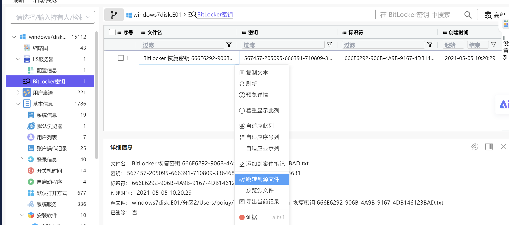
跳转源文件：
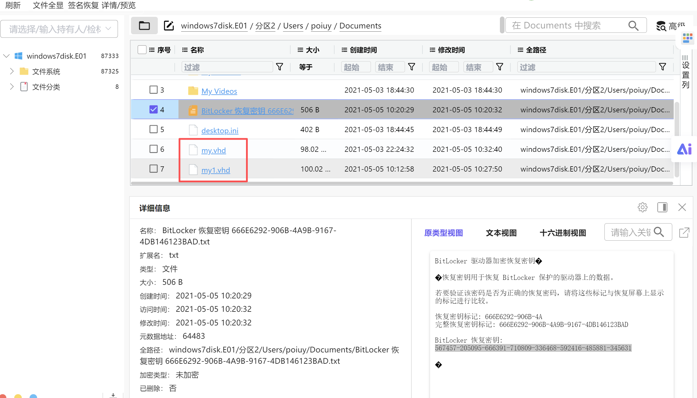

正确答案：my.vhd/my1.vhd

### 5. 请找出操作系统安装日期。

> 简答 · 10分

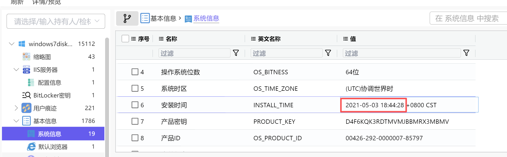

正确答案：2021-05-03 18:44:28

### 6. 请找出操作系统最后登录的用户。

> 简答 · 10分

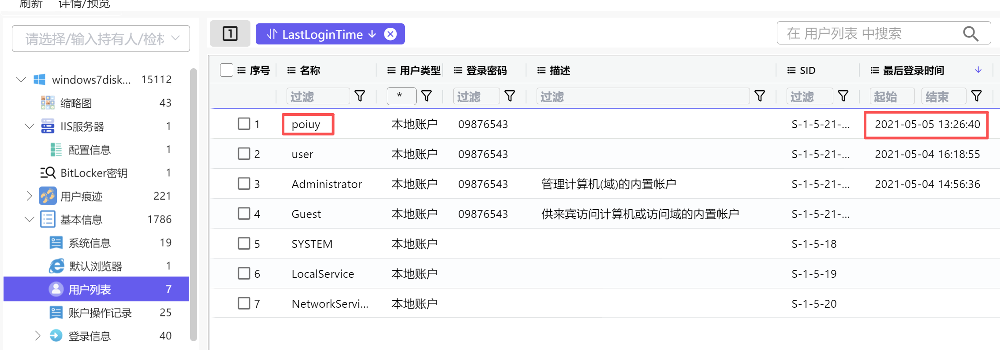

正确答案：poiuy

### 7. 请找出操作系统中安装的浏览器最后浏览过的网站域名

> 简答 · 10分 ｜ 格式：www.baidu.com

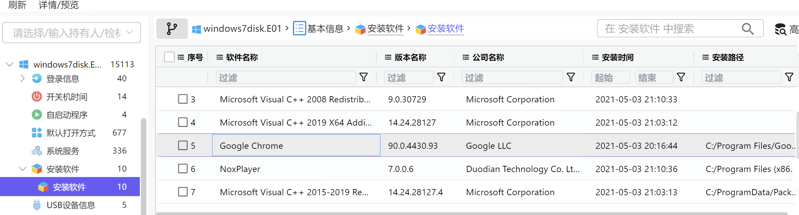
安装了Google Chrome：
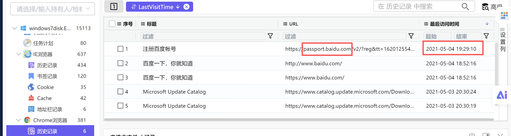

正确答案：passport.baidu.com

### 8. 请找出操作系统中安装的浏览器名称的对应的安装日期。（单选）

> 单选 · 10分

- A. 360浏览器 2021-05-03 20:16:43
- B. Edge浏览器 2021-05-03 20:26:44
- C. 谷歌浏览器 2021-05-03 20:16:44
- D. 搜狗极速浏览器 2021-06-03 20:16:44

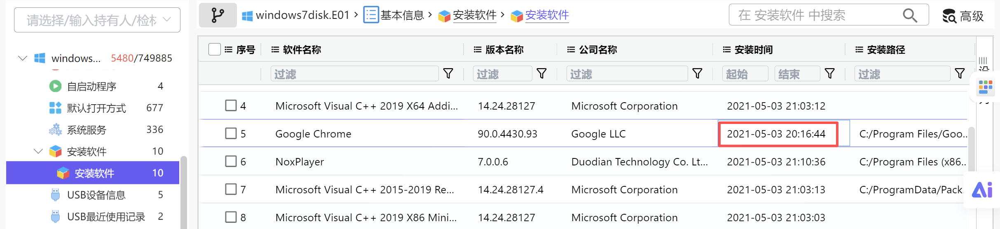

正确答案：C
### 9. 请找出操作系统版本号。

> 简答 · 10分

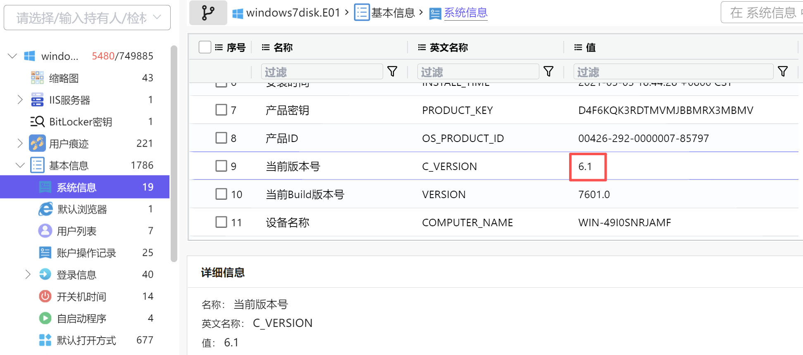

正确答案：6.1

### 10. 请找出操作系统设置的时区名称。

> 简答 · 10分 ｜ 格式：UTC+2

是这里找吗？不是
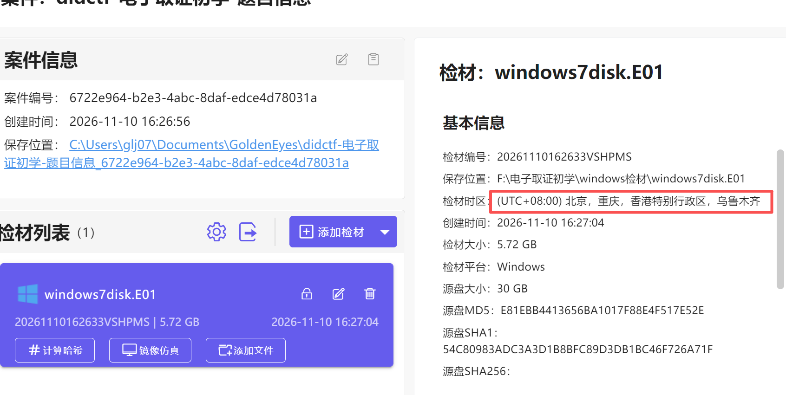
不要参考错了。真正去看：
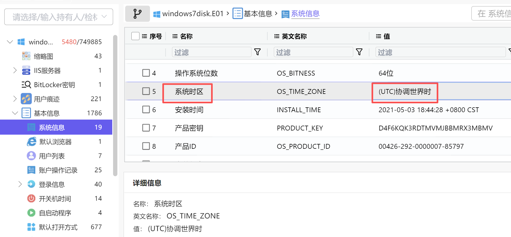

正确答案：UTC+0

### 11. 请找出操作系统中安装的浏览器“自动填充”中保存的网站密码信息（网站+用户名+密码）

> 简答 · 10分

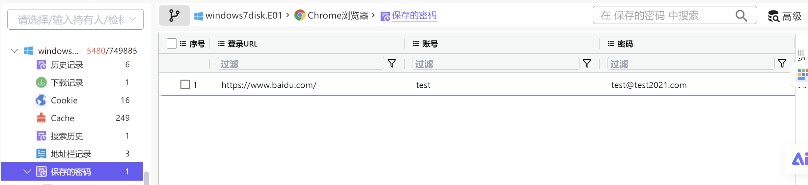

正确答案：https://www.baidu.com/+test+test@test2021.com

### 12. 请找出用户“poiuy”的SID。

> 简答 · 10分

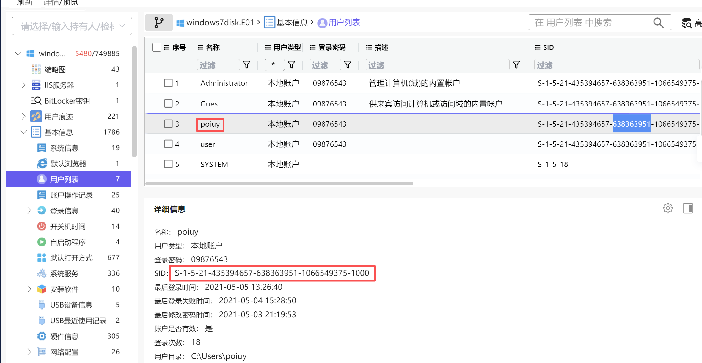

正确答案：S-1-5-21-435394657-638363951-1066549375-1000

### 13. 请给出源磁盘的大小（字节）。

> 简答 · 10分 ｜ 提示：一个扇区=512

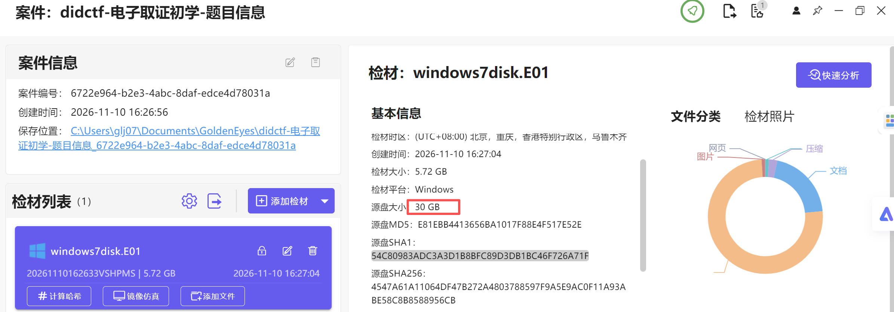

1 GB = 1024MB, 1MB = 1024 KB, 1 KB = 1024字节

30GB=30×1024×1024×1024=32212254720字节
或者精细一点：
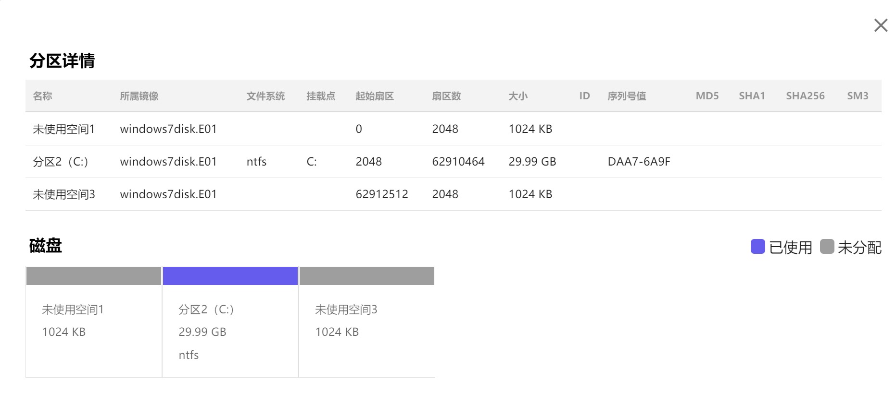

(2048+62910464+2048)512=32212254720

正确答案：32212254720

### 14. 请找出各分区文件系统类型。

> 简答 · 10分

如上图

正确答案：ntfs

### 15. 请找出曾经连接到该系统的U盘的品牌、序列号、最后插拔日期。

> 简答 · 10分 ｜ 例子：xx+xx+2024-03-12

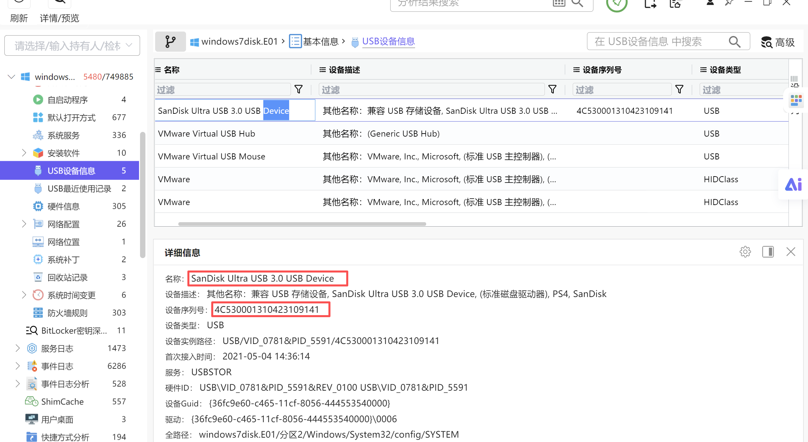

只有过一次接入。
正确答案：SanDisk+4C530001310423109141+2021-05-04

### 16. 请找出回收站中的文件的名称

> 简答 · 10分 ｜ 格式：2333.exe+1.txt+3.E01

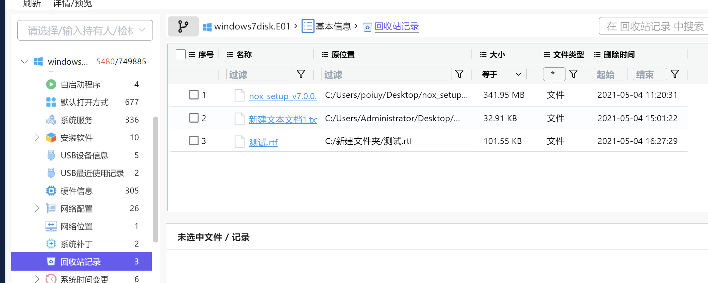

正确答案：nox_setup_v7.0.0.6_full.exe+新建文本文档1.txt+测试.rtf

### 17. 请找出使用Bitlocker加密的虚拟磁盘文件恢复密钥文件名是什么。

> 简答 · 10分

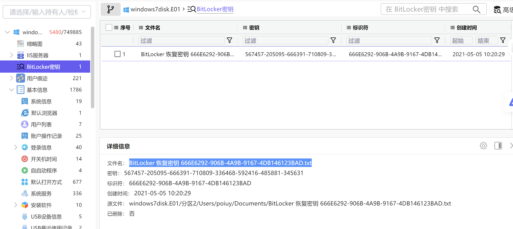

正确答案：BitLocker 恢复密钥 666E6292-906B-4A9B-9167-4DB146123BAD.txt

### 18. 请找出用户“poiuy”的登录密码。

> 简答 · 10分

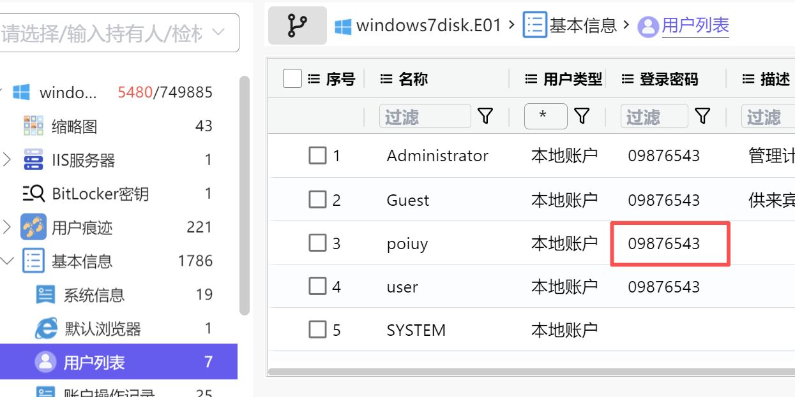

正确答案：09876543

## 二、内存取证

### 19. 请给出计算机内存创建北京时间？

> 简答 · 10分 ｜ 答案格式：2000-01-11 00:00:00

正确答案：2023-06-21 01:02:27

### 20. 请给出计算机内用户yang88的开机密码？

> 简答 · 10分 ｜ 答案格式：abc.123

方法一：使用火眼内存取证工具，直接能看到密码

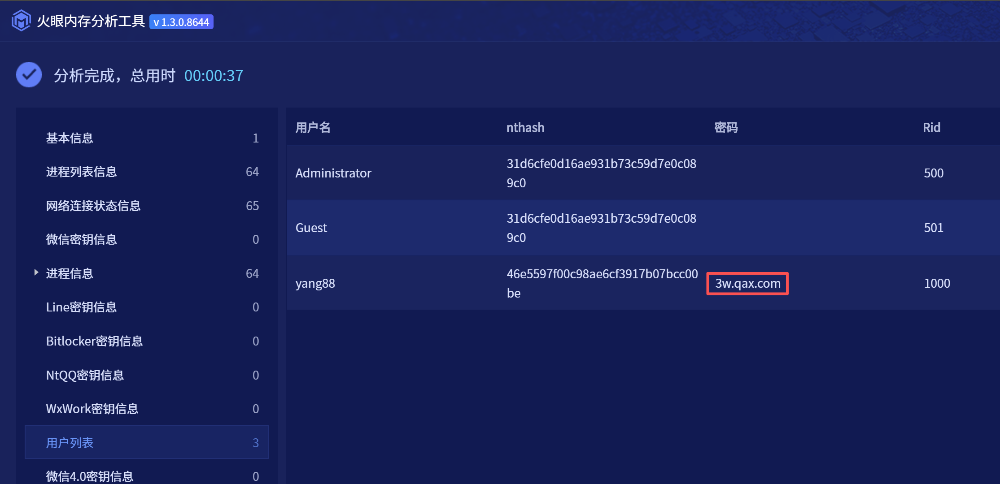

方法二：lovelymem里

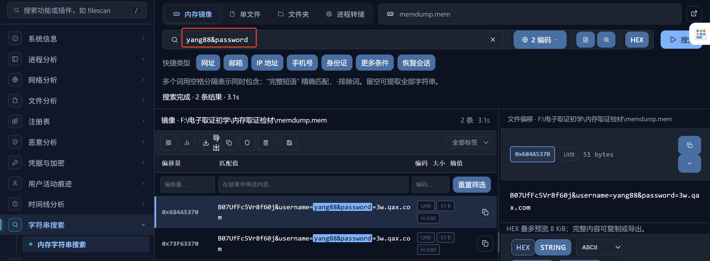

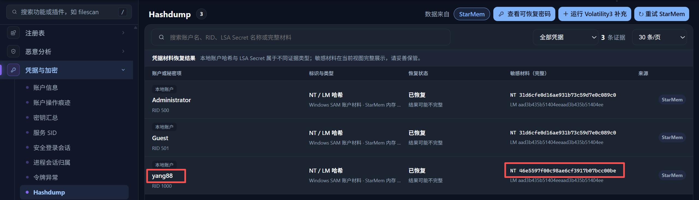

hashcat爆破这个：46e5597f00c98ae6cf3917b07bcc00be
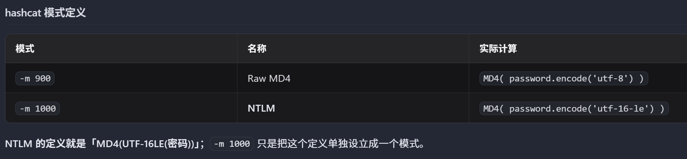
Windows 在 SAM 里存的不是裸 MD4，而是 UTF-16LE 版本。原因在于 NT 系列原生使用 UTF-16 编码，密码在进入哈希函数之前就已经是 UTF-16 字符串
所以hashcat爆破模式选择-m 1000

正确答案：3w.qax.com

### 21. 提取内存镜像中的USB设备信息，给出该USB设备的最后连接北京时间？

> 简答 · 10分 ｜ 答案格式：2000-01-11 00:00:00

看注册表：
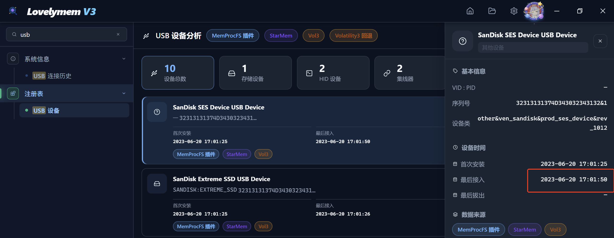
时间+8

正确答案：
### 22. 请给出用户yang88的LMHASH值？

> 简答 · 10分 ｜ 答案格式：字母小写

同一个密码，Windows 在 SAM 里用**两套历史遗留算法**各存一份：**LM 哈希**（1993 年的老古董，已废弃）和 **NT 哈希**（Windows NT 起使用的现代算法，也常被叫 NTLM 哈希）。

|      | LM 哈希（LAN Manager）                                                 | NT 哈希（NTLM hash）                       |
| ---- | ------------------------------------------------------------------ | -------------------------------------- |
| 诞生   | 1993 年，LAN Manager / Win9x 时代                                      | Windows NT 起，一直用到现在                    |
| 算法   | 密码转大写→截断/补齐到 14 字节→切成两个 7 字节→分别作为 DES 密钥加密固定串 KGS!@#$%→拼成 32 位十六进制 | MD4(UTF-16LE(密码))，直接出 16 字节 = 32 位十六进制 |
| 大小写  | 不区分（先转大写）                                                          | 区分                                     |
| 长度限制 | 最长 14 位（超过就丢）                                                      | 基本无限制（127 字符）                          |
| 安全性  | 极弱：无盐、DES 只有 56 位、拆成两段 7 字节可分别爆破 → 彩虹表/Ophcrack 几分钟出明文             | 弱但比 LM 强：无盐、无迭代 → 现代 GPU 每秒几十亿次，弱密码秒破  |
| 现状   | Vista 起默认禁用（NoLMHash 策略），只在特定兼容设置下才存                               | 默认存储，Win10/11 都靠它                      |
| 用途   | 早期 LM/NTLMv1 认证                                                    | NTLM 认证（质询/响应）、Pass-the-Hash、本地验证      |
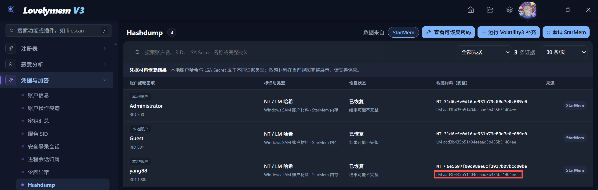

正确答案：aad3b435b51404eeaad3b435b51404ee

### 23. 请给出用户yang88访问过文件“提现记录.xlsx”的北京时间？

> 简答 · 10分 ｜ 答案格式：2000-01-11 00:00:00

正确答案：

### 24. 请给出“VeraCrypt”最后一次执行的北京时间？

> 简答 · 10分 ｜ 答案格式：2000-01-11 00:00:00

正确答案：

### 25. 分析内存镜像，请给出用户在“2023-06-20 16:56:57 UTC+0”访问过“维斯塔斯”后台多少次？

> 简答 · 10分 ｜ 答案格式：10

正确答案：

### 26. 请给出用户最后一次访问chrome浏览器的进程PID？

> 简答 · 10分 ｜ 答案格式：1234

正确答案：
