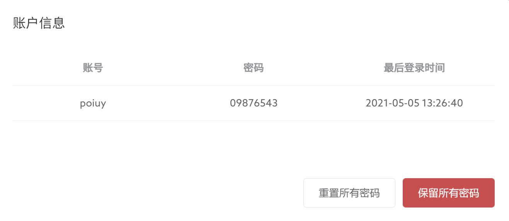
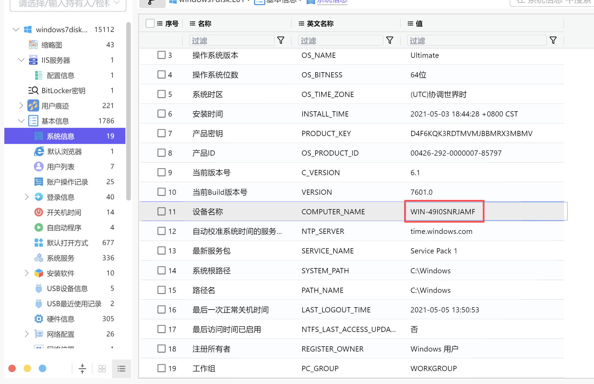
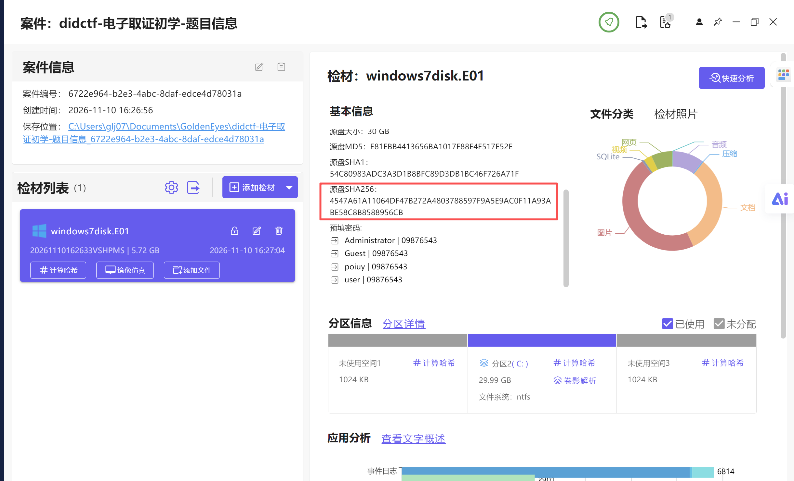
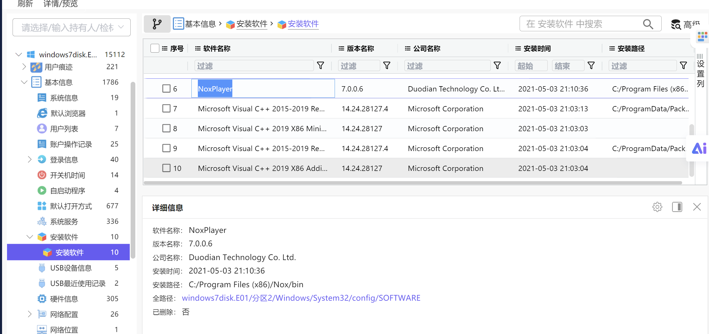
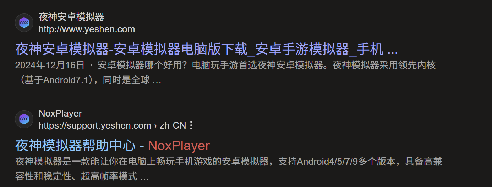
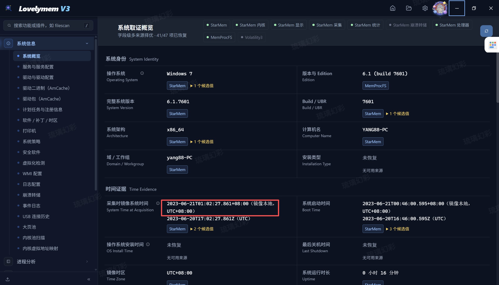

## 前言

**检材下载**

下载链接：[https://pan.baidu.com/s/1W3dvZatl0CNjWaUiNrzyfg?pwd=5p6c](https://pan.baidu.com/s/1W3dvZatl0CNjWaUiNrzyfg?pwd=5p6c)

哈希值：`无`

挂载/解压密码：`无`

## 一、计算机取证

### 仿真

### 1. 请找出操作系统主机名。

> 简答 · 10分

正确答案：WIN-49I0SNRJAMF
### 2. 请给出源磁盘的SHA256哈希值。

> 简答 · 10分

正确答案：4547A61A11064DF47B272A4803788597F9A5E9AC0F11A93ABE58C8B8588956CB
### 3. 请找出操作系统中安装的Android模拟器名称和安装日期。

> 简答 · 10分 ｜ 格式：雷电模拟器2025年06月26日

正确答案：夜神模拟器2021年05月03日
### 4. 请找出使用Bitlocker加密的虚拟磁盘文件。

> 简答 · 10分 ｜ 格式：xxx.xx/xxxx.xx

### 5. 请找出操作系统安装日期。

> 简答 · 10分

### 6. 请找出操作系统最后登录的用户。

> 简答 · 10分

### 7. 请找出操作系统中安装的浏览器最后浏览过的网站域名

> 简答 · 10分 ｜ 格式：www.baidu.com

### 8. 请找出操作系统中安装的浏览器名称的对应的安装日期。（单选）

> 单选 · 10分

- A. 360浏览器 2021-05-03 20:16:43
- B. Edge浏览器 2021-05-03 20:26:44
- C. 谷歌浏览器 2021-05-03 20:16:44
- D. 搜狗极速浏览器 2021-06-03 20:16:44

### 9. 请找出操作系统版本号。

> 简答 · 10分

### 10. 请找出操作系统设置的时区名称。

> 简答 · 10分 ｜ 格式：UTC+2

### 11. 请找出操作系统中安装的浏览器“自动填充”中保存的网站密码信息（网站+用户名+密码）

> 简答 · 10分

### 12. 请找出用户“poiuy”的SID。

> 简答 · 10分

### 13. 请给出源磁盘的大小（字节）。

> 简答 · 10分 ｜ 提示：一个扇区=512

### 14. 请找出各分区文件系统类型。

> 简答 · 10分

### 15. 请找出曾经连接到该系统的U盘的品牌、序列号、最后插拔日期。

> 简答 · 10分 ｜ 例子：xx+xx+2024-03-12

### 16. 请找出回收站中的文件的名称

> 简答 · 10分 ｜ 格式：2333.exe+1.txt+3.E01

### 17. 请找出使用Bitlocker加密的虚拟磁盘文件恢复密钥文件名是什么。

> 简答 · 10分

### 18. 请找出用户“poiuy”的登录密码。

> 简答 · 10分

## 二、内存取证

### 19. 请给出计算机内存创建北京时间？

> 简答 · 10分 ｜ 答案格式：2000-01-11 00:00:00

正确答案：2023-06-21 01:02:27
### 20. 请给出计算机内用户yang88的开机密码？

> 简答 · 10分 ｜ 答案格式：abc.123

### 21. 提取内存镜像中的USB设备信息，给出该USB设备的最后连接北京时间？

> 简答 · 10分 ｜ 答案格式：2000-01-11 00:00:00

### 22. 请给出用户yang88的LMHASH值？

> 简答 · 10分 ｜ 答案格式：字母小写

### 23. 请给出用户yang88访问过文件“提现记录.xlsx”的北京时间？

> 简答 · 10分 ｜ 答案格式：2000-01-11 00:00:00

### 24. 请给出“VeraCrypt”最后一次执行的北京时间？

> 简答 · 10分 ｜ 答案格式：2000-01-11 00:00:00

### 25. 分析内存镜像，请给出用户在“2023-06-20 16:56:57 UTC+0”访问过“维斯塔斯”后台多少次？

> 简答 · 10分 ｜ 答案格式：10

### 26. 请给出用户最后一次访问chrome浏览器的进程PID？

> 简答 · 10分 ｜ 答案格式：1234
