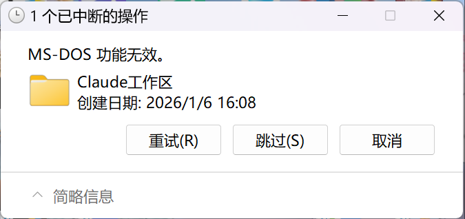

> 一次删目录失败，最后牵出「AI agent 在 Windows 上用 CMD 语法写 bash 命令」这个系统性问题。
> 真正值得注意的是：这个坑会让**整棵目录树的备份与删除静默失效**，而常规排查手段全都看不见它。

---

## 1. 一句话结论

Windows 的保留设备名 `nul`，只在 `cmd.exe` / PowerShell 里是空设备；
在 **Git Bash / MSYS / Cygwin 里它就是一个普通文件名**。
于是 AI 习惯性写的 `2>nul`、`>nul` 会被 bash 当成重定向到文件，**在当前目录真的建出一个名为 `nul` 的文件**。
这个文件一旦落地，用正常手段删不掉，并且会让它所在目录的**递归删除、复制、备份、重命名全部失败**。

---

## 2. 现象

删除一个桌面工作目录时，资源管理器弹出：



```
1 个已中断的操作
MS-DOS 功能无效。
```

换成 `Remove-Item` 也一样失败，报错信息指向了奇怪的地方：

```
Remove-Item : 函数不正确。 : '...\临时分析\历史题目\nul'
```

而更迷惑的是：`Test-Path '...\nul'` 返回 **False**，看起来那个文件根本不存在。

---

## 3. 走过两次弯路（这部分比结论更值钱）

排查初期，我给出过两个错误判断，后来都被推翻。记录下来是因为**这两个方向都非常"合理"，也正是大多数人会走的弯路**。

| 误判 | 当时的"证据" | 为什么是错的 |
|---|---|---|
| **资源管理器句柄失效** | 刚用 `Remove-Item` 删掉了该目录下的一个子目录，时间点完全吻合；报错发生在删除操作卡住的瞬间 | 关掉资源管理器窗口后重试，依旧失败。句柄失效只影响单个窗口，不会让 PowerShell 也报"函数不正确" |
| **火绒 HIPS 驱动拦截** | 本机 `HipsDaemon` 正在运行；安全软件的过滤驱动确实会返回非标准错误码，Windows 就翻译成含糊的"MS-DOS 功能无效" | 换上 `\\?\` 长路径前缀后一次就删掉了。杀毒软件不会因为路径写法不同就放行 |

第三个方向才命中：**报错信息里已经写了答案**——`函数不正确` 指向的文件名是 `nul`。

> 教训：Windows 报 `ERROR_INVALID_FUNCTION`（错误码 1）时，**第一件事应该是查路径里的保留设备名**，而不是怀疑句柄或杀软。这个错误码是"参数根本不被识别"的意思，天然指向命名层问题。

---

## 4. 根因：两套命名语义的冲突

同一个字符串 `nul`，在不同层里有完全不同的含义：

| 层 | `nul` 的语义 |
|---|---|
| Win32 API / `cmd.exe` / PowerShell | **空设备**（null device），写入即丢弃 |
| POSIX / Git Bash / MSYS2 / Cygwin | **普通文件名**，真正的空设备是 `/dev/null` |

所以下面这条命令在 cmd 里毫无问题，在 bash 里却会留下垃圾：

```bash
# 你以为：丢弃错误输出
# 实际：在当前目录创建了一个名为 "nul" 的文件，把 stderr 写进去
some_command 2>nul
```

更反直觉的是它的**生命周期**：

1. **创建成功** —— MSYS 的 `open()` 走自己那套路径处理，绕过了 Win32 的保留名拦截
2. **事后删不掉** —— 之后任何 Win32 路径的删除/重命名，都会把 `nul` 解析成空设备而不是文件，于是返回 `ERROR_INVALID_FUNCTION`

也就是说：**用 POSIX 语义创建，用 Win32 语义访问 —— 结果是永久孤儿文件。**

这甚至不是 Git Bash 的 bug，而是两套命名体系共存于同一文件系统的必然产物。最早可查的同类记录能追溯到 **2008 年 Git 邮件列表**：某次提交往 `t/t5100/nul` 放测试文件，直接导致 git tree 对 Cygwin/Windows 不兼容，原文写着：

> On Windows, the file name "nul" is reserved, **regardless of path**, and cannot be created or deleted.

---

## 5. 为什么说这是 AI 造出来的

保留名问题有 18 年历史，但最近突然变密集。原因很直接：**AI 模型习惯性输出 Windows CMD 语法**。

模型训练语料里，Windows 教程几乎全是 `2>nul` 这种写法；模型照抄毫无恶意。但很多 agent 的 shell 工具在 Windows 上实际调用的是 **Git Bash**，于是每一次"我想屏蔽报错"的动作，都在给磁盘种一个雷。

### 5.1 文件内容就是铁证

我把全盘 11 个 `nul` 的内容全部读了出来。它们装的东西，正是**本该被丢弃的 stderr**：

| 路径 | 大小 | 内容 |
|---|---|---|
| `...\琉璃帝国RTS即时战略\nul` | 51 B | `dir: cannot access '/b': No such file or directory` |
| `...\AppData\Local\Temp\vprev\nul` | 51 B | 同上（同一条命令的副本） |
| `...\反诈模拟小程序研发\nul` | 43 B | `错误: "path:pattern" 的指定无效模式` |
| `...\晚间活动项目制作\_server_review\backend\nul` | 26 B | `信息: 找不到 "python3"` |
| `...\角色扮演RolePlay\nul` | 0 B | 空 |
| `...\晚间活动项目制作\nul` | 0 B | 空 |
| `D:\VoxEMW\nul` | 0 B | 空 |
| `...\第三届大数据智能警务挑战赛\99_回收站_可清空\nul` | — | — |
| `...\第三届大数据智能警务挑战赛\平台侦察\04_云实验环境\nul` | — | — |
| `AppData\Local\Temp\exec_yi_nultest\sub\nul` | 10 B | `0123456789`（某次专门测 nul 行为） |

注意第一条：`dir: cannot access '/b'`。**`dir /b` 是 cmd 的参数**，bash 的 `ls` 当然不认识；
第二条的 `where /R` 也是纯 cmd 命令。这直接证明：**agent 把 cmd 语法丢给了 bash 执行。**

而那句 `2>nul` 的本意是"丢弃错误"，实际效果是**把错误藏进了一个叫 `nul` 的文件**。
所以 agent 以为错误被抑制了，其实报错信息一直躺在磁盘里，只是没人看见。

### 5.2 时间线也吻合

11 个文件的时间戳集中在 `2026-10-03 ~ 10-24`，全部落在各 AI 项目被 agent 施工的时期；
所在目录也清一色是 AI 参与的项目。会话库里能搜到 **124 条** `2>nul` 型 bash 调用，例如：

```bash
where claude 2>nul || true
chcp 65001 >nul & dir "..." /b 2>nul
dir /s /b "..." 2>nul & where /r "..." x.html 2>nul
```

---

## 6. 业界怎么看：已被定性为 AI-agent 特有故障

同一个坑，不同团队独立踩了三遍，而且都有正式记录：

| 来源 | 时间 | 要点 |
|---|---|---|
| [gsd-build/gsd-2 Issue #157](https://github.com/gsd-build/gsd-2/issues/157) | 2026-03 | 标题直译：**「Windows：LLM 生成的 NUL 重定向在 Git Bash 里造出删不掉的文件」**。症状清单与本文完全一致：删不掉（Explorer / `del` / `rm` 全废）、**让资源管理器行为异常**、触发其他扫描目录的程序报错、只能用 `\\?\` 清除 |
| [NousResearch/hermes-agent PR #69293](https://github.com/NousResearch/hermes-agent/pull/69293) | 2026-07 | 同一根因。额外指出一个危害：目录若在 OneDrive 等同步位置，会产生**无法上传的保留名，造成永久同步失败** |
| [gastownhall/beads commit 7d4bf5a](https://github.com/gastownhall/beads/commit/7d4bf5a0f01c103c4cb2413ed09aa8e9903c3006) | 2025-10 | `$(shell ...)` 在 Windows 走 MSYS bash，那里 `nul` 不是设备而是路径 |
| [Microsoft Q&A：Undeletable File named Con, Aux](https://learn.microsoft.com/en-us/answers/questions/3798066/undeletable-file-named-con-aux-etc-heres-some-help) | 2025-07 | 官方社区确认保留名删不掉，给出 `del \?\C:...` 解法 |
| [Microsoft 保留名清单](https://learn.microsoft.com/en-nz/answers/questions/3259350/how-do-i-delete-this-off-my-computer) | — | `CON, PRN, AUX, NUL, COM1-9, LPT1-9` 禁用清单 |

### 6.1 一个容易踩错的技术细节

很自然的想法是"在工具层用正则把 `2>nul` 全局替换成 `2>/dev/null`"。**这个方案在 hermes-agent 的评审里被明确打回了**：

> 新正则**不是 quote-aware**，会把引号里的字面量也改掉：
> `printf '%s\n' '2>NUL'` 会被改成 `'2>/dev/null'`，Python/JSON 代码片段里的 `>nul` 也会被篡改。

要正确实现，必须做 **token / quote-aware 重写**：只替换**未加引号**的重定向符，并保护
单引号、双引号、转义、注释、heredoc 和命令替换里的内容（最终落地在 [PR #65363](https://github.com/NousResearch/hermes-agent/pull/65363)）。

> 这个细节说明：修这类问题**不能在字符串层偷懒**，必须理解 shell 的语法结构。

---

## 7. 危害分级

1. **目录级功能失效（最严重）**
   该目录下任何递归删除、复制、备份、重命名都会失败。备份软件可能整棵树静默跳过，而你以为备份成功了。
2. **误导排查方向**
   报错信息含糊（"MS-DOS 功能无效"），资源管理器行为异常，极易被误判为句柄、权限或杀毒软件问题。
3. **反向隐蔽**
   `2>nul` 本想丢弃错误，实际把错误写进文件 —— agent 以为没有报错，实际报错被藏起来了。
4. **云同步阻塞**
   若目录在 OneDrive / 同步盘里，该文件无法上传，会造成永久同步失败。
5. **常规工具查不出来**
   `Test-Path` 返回 False（假阴性）、`Remove-Item` 报错、资源管理器卡住、`dir` 也不老实。

---

## 8. 检测

```powershell
# 全盘快速扫（Everything 索引，最可靠）
& 'C:\Users\glj07\.codex\bin\es\es.exe' -w nul -n 50

# 指定目录递归扫
Get-ChildItem -LiteralPath '<目录>' -Recurse -File -Force -ErrorAction SilentlyContinue |
  Where-Object { $_.Name -match '^(nul|con|aux|prn|com[1-9]|lpt[1-9])(\..*)?$' }
```

> ⚠️ 注意：`Test-Path "...\nul"` 会返回 **False 假阴性**。
> 必须加扩展长路径前缀才能正确 stat：`Test-Path -LiteralPath '\\?\C:\...\nul'`

本机整理了一个带 dry-run 的扫描/清理脚本，见文末附录。

---

## 9. 清理：唯一有效的手段

```powershell
# 单删：必须用 \\?\ 扩展长路径前缀
[System.IO.File]::Delete('\\?\C:\path\to\nul')

# 整个目录删（目录内含 nul 时）
cmd /c rd /s /q "\\?\C:\path\to\dir"
```

两个反直觉点，务必记住：

- `Remove-Item -LiteralPath '...\nul'` **无效**，会报"函数不正确"
- 中文路径**不要手打**，用 `Get-ChildItem` 拿到的 `$_.FullName` 去拼 `\\?\`，否则编码差异会导致找不到

---

## 10. 避免：三层防御

### 第 1 层：按执行器选空设备（治本）

| 执行器 | 正确写法 | 禁止 |
|---|---|---|
| Git Bash / MSYS / bash / sh | `2>/dev/null` | ❌ `2>nul`、`>nul`、`> NUL` |
| PowerShell | `2>$null` | ❌ `2>nul` |
| cmd.exe / `.bat` 文件内部 | `2>nul` | — |

### 第 2 层：认出 cmd 语法，不要丢给 bash

一条命令里出现这些特征，说明它是 **cmd 语法**：

- `dir /s`、`dir /b`、`where /R` 这类**斜杠参数**
- `chcp ... >nul`
- 用 `&` 串联多个命令
- `%VAR%` 形式的环境变量

要执行就显式走 cmd（Git Bash 里必须用双斜杠 `//c`）：

```bash
cmd.exe //c "你的 cmd 命令"
```

### 第 3 层：工具层修复

若自己维护 agent 框架，在 shell 执行器里做 **quote-aware 重写**，
只替换未加引号的重定向符号，保护引号字面量、注释、heredoc、命令替换。

---

## 11. 本机各端风险面

| 端 | shell 工具 | 风险 |
|---|---|---|
| DSH | `pwsh`（PowerShell），且 bash 工具在 win32 被平台门控禁用 | 安全 |
| Claude Code | Windows 上 Bash 工具即 Git Bash | **高危** |
| Codex / ZCode CLI / Cline 等 | 走 Git Bash | **高危** |
| 任何"写 `.bat` 再由 cmd 执行"的路径 | cmd | 安全 |

---

## 12. 结语

这个问题的严重性不在"制造了几个垃圾文件"，而在于它**同时具备三个特性**：

- **静默**：不报错（因为错误被自己的重定向吞进了垃圾文件）
- **持久**：删不掉，会一直留在目录里
- **连坐**：让整个目录的备份与删除失效

再加上报错信息极具误导性，排查成本极高。我这次前后花了十几个来回，两个判断方向都是错的，最后答案藏在一条 `Remove-Item` 报错里那个不起眼的 `nul` 上。

如果只记一句话：**Windows 上写 shell 命令，先想清楚这条命令由谁执行，再决定用 `nul` 还是 `/dev/null`。**

---

## 附录：扫描/清理脚本

```powershell
<#
    扫描（默认 dry-run）并可选删除 Windows 保留设备名文件。
    用法：
        .\remove-reserved-names.ps1                    # 扫默认目录，只报告
        .\remove-reserved-names.ps1 -Path 'D:\xx' -Apply
        .\remove-reserved-names.ps1 -All -Apply        # 全盘
#>
[CmdletBinding()]
param(
    [string[]] $Path,
    [switch]   $Apply,
    [switch]   $All
)

$ErrorActionPreference = 'Continue'
$ReservedPattern = '^(nul|con|aux|prn|com[1-9]|lpt[1-9])(\..*)?$'

if ($All) {
    $Path = @(Get-PSDrive -PSProvider FileSystem | Where-Object { $_.Used -ne $null } | ForEach-Object { $_.Root })
}
if (-not $Path) {
    $Path = @("$env:USERPROFILE\Desktop", "$env:USERPROFILE\Downloads") | Where-Object { Test-Path -LiteralPath $_ }
}

$found = foreach ($root in $Path) {
    if (-not (Test-Path -LiteralPath $root)) { continue }
    Get-ChildItem -LiteralPath $root -Recurse -File -Force -ErrorAction SilentlyContinue |
        Where-Object { $_.Name -match $ReservedPattern } |
        ForEach-Object {
            $ext = '\\?\' + $_.FullName
            $preview = ''
            try {
                $fi = [System.IO.FileInfo]::new($ext)
                if ($fi.Length -le 512) { $preview = ([System.IO.File]::ReadAllText($ext)) -replace "`r?`n", ' / ' }
            } catch { }
            Write-Host ("FOUND  {0}  {1}" -f $_.FullName, $preview.Trim())
            [pscustomobject]@{ Path = $_.FullName }
        }
}

if (-not $found) { Write-Host 'clean'; exit 0 }
if (-not $Apply) { Write-Host 'dry-run only, add -Apply to delete'; exit 0 }

foreach ($f in $found) {
    $ext = '\\?\' + $f.Path
    try { [System.IO.File]::Delete($ext); Write-Host "DELETED  $($f.Path)" }
    catch { Write-Host "FAILED   $($f.Path) : $($_.Exception.Message)" }
}
```

> 一句话记忆法：**bash 用 `/dev/null`，PowerShell 用 `$null`，只有 cmd/.bat 里才用 `nul`。**
